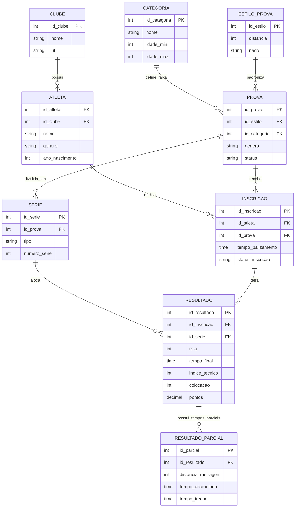

# Relatório Técnico - 29º Troféu Alexandre Pussieldi 2025
**Disciplina:** Banco de Dados / Modelagem  
**Objetivo:** Estruturação relacional e consultas estatísticas para o sistema FASE Aquática.

---

## 1. Modelagem Relacional de Dados

Com base na análise do sistema oficial FASE Aquática, foi desenvolvido um modelo Entidade-Relacionamento focado na Terceira Forma Normal (3FN), garantindo integridade referencial e eliminação de redundâncias. 

A arquitetura adota a separação de cadastros básicos, fluxo de inscrições (pré-evento) e registro de resultados parciais/finais (durante/pós-evento).

### Diagrama Entidade-Relacionamento (ER)


*(Renderização do modelo relacional)*



### Justificativas Técnicas de Modelagem:
1. **Aplicação da 1FN (Valores Atômicos):** A entidade "PROVA" foi segmentada para extrair o estilo e a distância para a tabela `ESTILO_PROVA` (distância + nado), evitando redundância textual. Os tempos parciais (25m, 50m) foram extraídos para a tabela `RESULTADO_PARCIAL` (relacionamento 1:N), garantindo a atomicidade e evitando múltiplas colunas de tempo na tabela principal de resultados.
2. **Separação de Fluxo (Inscrição vs. Resultado) [3FN]:** Evitou-se atrelar o atleta diretamente ao resultado da raia. No mundo real, o atleta realiza uma `INSCRIÇÃO` prévia. Apenas as inscrições validadas e alocadas em uma `SÉRIE` (Bateria) geram um `RESULTADO` definitivo, mitigando registros nulos em caso de ausência (W.O.).
3. **Idade como Atributo Derivado:** A entidade `ATLETA` armazena o `ano_nascimento` (dado estático) em vez de "idade". A idade é calculada dinamicamente via SQL para enquadramento nas categorias, evitando que o banco de dados fique obsoleto anualmente.

---

## 2. Análise Crítica e Implementação das Consultas (Views)

Durante a fase de desenvolvimento das consultas estatísticas (`sp_quatro_de_migalhas` e `sp_atlas_e_cubos`), uma ferramenta de Inteligência Artificial generativa foi utilizada para a prototipagem dos códigos. Ao avaliar o script gerado inicialmente para a apuração de pontos, identificou-se uma **alucinação estrutural e de regra de negócio**.

A IA pressupôs erroneamente a existência de uma coluna estática `idade` na tabela de atletas e aplicou faixas etárias inexistentes no regulamento (ex: inserindo 12 a 13 anos para a categoria Mirim).


*(Figura 1: Geração inicial da IA com regra de negócio incorreta e uso de campo derivado estático)*

Para corrigir essa inconsistência, foi aplicado um *prompt* corretivo de engenharia reversa. O modelo foi instruído a respeitar as categorias oficiais da FASE Aquática (Pré-Mirim: até 9 anos; Mirim: 10 a 11 anos) e a substituir a referência estática por um cálculo dinâmico baseado no `ano_nascimento`.


*(Figura 2: Intervenção técnica e atualização do código SQL para validação matemática de datas)*

### 2.1. Scripts Finais e Ordenação de Dados

Abaixo estão os scripts de criação das *Views* adaptados para SQLite, juntamente com as consultas (aplicando a cláusula `ORDER BY` externamente para definir o ranking).

#### Quadro de Medalhas Oficial (`sp_quatro_de_migalhas`)

A consulta abaixo utiliza a técnica de pivoteamento para transformar posições em colunas de Ouro, Prata e Bronze.

```sql
CREATE VIEW sp_quatro_de_migalhas AS
SELECT 
    c.nome AS Clube,
    SUM(CASE WHEN r.colocacao = 1 THEN 1 ELSE 0 END) AS Ouro,
    SUM(CASE WHEN r.colocacao = 2 THEN 1 ELSE 0 END) AS Prata,
    SUM(CASE WHEN r.colocacao = 3 THEN 1 ELSE 0 END) AS Bronze,
    COUNT(r.id_resultado) AS Total_Medalhas
FROM CLUBE c
JOIN ATLETA a ON c.id_clube = a.id_clube
JOIN INSCRICAO i ON a.id_atleta = i.id_atleta
JOIN RESULTADO r ON i.id_inscricao = r.id_inscricao
WHERE r.colocacao IN (1, 2, 3) 
GROUP BY c.id_clube, c.nome;
```

**Consulta para visualização (Ranqueamento Olímpico):**
```sql
SELECT * FROM sp_quatro_de_migalhas 
ORDER BY Ouro DESC, Prata DESC, Bronze DESC;
```

| Clube | Ouro | Prata | Bronze | Total_Medalhas |
| :--- | :--- | :--- | :--- | :--- |
| AABB-RECIFE | 1 | 1 | 1 | 3 |
| SPORT/PE | 1 | 0 | 0 | 1 |
| FBDA/NATAÇÃO EM REDE | 1 | 0 | 0 | 1 |
| CEPE - NATAL | 0 | 1 | 0 | 1 |

#### Desempenho por Equipe e Categoria (`sp_atlas_e_cubos`)

Esta consulta faz a validação rigorosa da idade (Ano Atual - Ano de Nascimento) para barrar fraudes nas categorias de base.

```sql
CREATE VIEW sp_atlas_e_cubos AS
SELECT 
    c.nome AS Clube,
    cat.nome AS Categoria,
    SUM(r.pontos) AS Pontuacao_Total
FROM CLUBE c
JOIN ATLETA a ON c.id_clube = a.id_clube
JOIN INSCRICAO i ON a.id_atleta = i.id_atleta
JOIN RESULTADO r ON i.id_inscricao = r.id_inscricao
JOIN SERIE s ON r.id_serie = s.id_serie
JOIN PROVA p ON s.id_prova = p.id_prova
JOIN CATEGORIA cat ON p.id_categoria = cat.id_categoria
WHERE 
    (cat.nome = 'Pré-Mirim' AND (CAST(strftime('%Y', 'now') AS INTEGER) - a.ano_nascimento) <= 9)
    OR 
    (cat.nome LIKE 'Mirim%' AND (CAST(strftime('%Y', 'now') AS INTEGER) - a.ano_nascimento) BETWEEN 10 AND 11)
GROUP BY c.id_clube, c.nome, cat.nome;
```

**Consulta para visualização (O Campeão Geral de Pontos):**
```sql
SELECT * FROM sp_atlas_e_cubos 
ORDER BY Pontuacao_Total DESC;
```

| Clube | Categoria | Pontuacao_Total |
| :--- | :--- | :--- |
| AABB-RECIFE | Mirim 1 | 63.0 |
| SPORT/PE | Pré-Mirim | 25.0 |
| FBDA/NATAÇÃO EM REDE | Mirim 1 | 25.0 |
| CEPE - NATAL | Mirim 1 | 22.0 |
| VILA PARAHYBA | Mirim 1 | 16.0 |
| SPORT/PE | Mirim 1 | 14.0 |

#### Bônus: Classificação Individual de Atletas (Ranking)

Para consolidar os vencedores individuais do campeonato (quem acumulou mais pontos independentemente da prova):

```sql
SELECT 
    a.nome AS Atleta,
    c.nome AS Clube,
    SUM(r.pontos) AS Pontuacao_Total
FROM ATLETA a
JOIN CLUBE c ON a.id_clube = c.id_clube
JOIN INSCRICAO i ON a.id_atleta = i.id_atleta
JOIN RESULTADO r ON i.id_inscricao = r.id_inscricao
GROUP BY a.id_atleta, a.nome, c.nome
ORDER BY Pontuacao_Total DESC;
```
